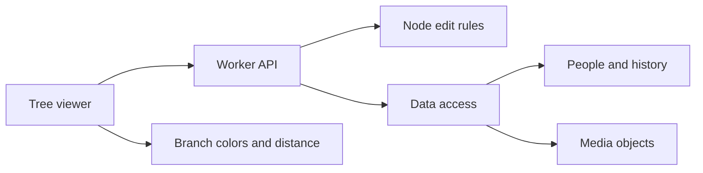

Anyone can read the shared tree. A registered user can add people and edit unlocked nodes. A creator can lock a node. There is no membership or owner role.

The arrows show calls and data access. They are not a sequence of states.

The Worker uses one internal tree record with ID `human`. The database retains `tree_id` columns for stored records. The viewer uses `/api/tree`. Public responses do not include account email addresses. Comments can be edited or deleted only by their author.

The Family map reads the same tree at `/family-map/`. A person selector and a family level selector control the view. Wide descendant branches fit into compact groups. The map links back to the full tree for edits.

Edits read a sequence and the current entities. Validation checks node revisions, locks, relationship endpoints, and graph rules. The database batch writes only if the sequence is still current. If another write wins, the Worker reads the data again and repeats validation.

Each card samples a continuous color field at its layout position. Fixed seeded cell centers use 1,000 colors from the palette file. Colors are light enough for black card text. Colors remain stable when the selection changes, but can change when the layout changes. Each parent, child, or partner link adds one step. Cards and connections become less saturated and slightly darker with distance; all remain visible. Siblings who share a recorded parent and their connections to that parent are highlighted. The viewer starts with the most connected person selected. Clear selection removes the distance emphasis. Labels give the distance in text. Selecting a person does not move the viewport.

Timelapse uses one layout for all years. Cards enter from a visible relative when possible, and a sound can mark arrivals. The viewport stays in place while the year changes.

People use circular nodes. The measured name, dates, and optional photo fit inside the circle. A radial starting arrangement and D3 forces place people and family junctions in both axes. A circle collision force leaves space between nodes. The layout is calculated once per state and reused across timelapse years.

Each visible parent set has its own junction. Paths join the parents to that junction and then join the junction to each child. Lines from different parent sets are not merged. Arrowheads point to children. Shared segments retain relationship IDs for highlighting. Dashed paths mark non-birth links. Mixed paths include both birth and non-birth links.

Connections use a short route around circular node bounds, with rounded bends. A background stroke separates lines at crossings. This gap does not indicate a family junction. Routing can keep a single straight segment when it has no obstacle.

The zoom range is 0.5% to 250%. Buttons, mouse, and touch use the same range. Fit tree fits the full layout to the available canvas, including space for the timelapse player. Selection keeps the viewport in place. The first view fits the full tree.

When a death year is known but the birth year is not, the card shows `????` in place of the birth year.

See [node locks](node-locks.md), [migration and limits](../../README.md), and [verification results](verification.md).

## Gaps

The viewer and validator load the full graph. Population-scale loading, rendering, and concurrent writes need a separate design and load tests. Browser checks do not contribute to Node coverage. Point crossings can remain in a connected family graph. Routing uses twelve passes and can fall back to a direct segment when it cannot find a route. The current 421-person snapshot has no circle collisions, paths through nodes, or shared segments between unrelated families. This is not a proof for all future data.
