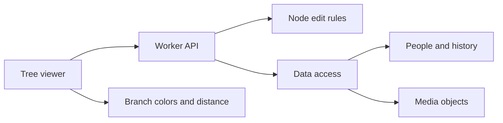

Anyone can read the shared tree. A registered user can add people and edit unlocked nodes. A creator can lock a node. There is no membership or owner role.

The arrows show calls and data access. They are not a sequence of states.

The Worker uses one internal tree record with ID `human`. The database retains `tree_id` columns for stored records. The viewer uses `/api/tree`. Public responses do not include account email addresses. Comments can be edited or deleted only by their author.

Edits read a sequence and the current entities. Validation checks node revisions, locks, relationship endpoints, and graph rules. The database batch writes only if the sequence is still current. If another write wins, the Worker reads the data again and repeats validation.

Branch colors blend across parent, child, and partner links and remain stable when the selection changes. Each link adds one step. Cards and connections become less saturated and slightly darker with distance; all remain visible. The viewer starts with the most connected person selected. Clear selection removes the distance emphasis. Labels give the distance in text. Selecting a person does not move the viewport.

Timelapse uses one layout for all years. Cards enter from a visible relative when possible, and a sound can mark arrivals. The viewport stays in place while the year changes.

See [node locks](node-locks.md), [migration and limits](../../README.md), and [verification results](verification.md).

## Gaps

The viewer and validator load the full graph. Population-scale loading, rendering, and concurrent writes need a separate design and load tests. Browser checks do not contribute to Node coverage.
