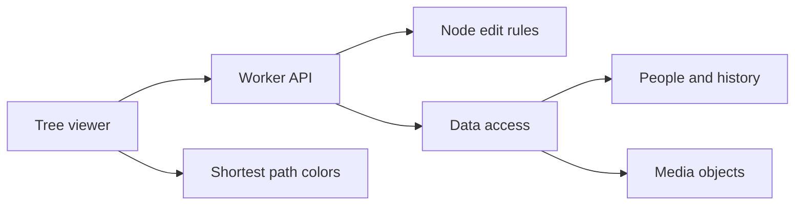

Anyone can read the shared tree. A registered user can add people and edit unlocked nodes. A creator can lock a node. There is no membership or owner role.

The arrows show calls and data access. They are not a sequence of states.

The Worker uses one internal tree record with ID `human`. The database retains `tree_id` columns for stored records. The viewer uses `/api/tree`. Public responses do not include account email addresses. Comments can be edited or deleted only by their author.

Edits read a sequence and the current entities. Validation checks node revisions, locks, relationship endpoints, and graph rules. The database batch writes only if the sequence is still current. If another write wins, the Worker reads the data again and repeats validation.

Relation colors count the shortest path from the selected person. With no selection, the viewer uses the first live person. Each parent, child, and partner link adds one step. Colors stop changing after six steps. Gray means there is no recorded path. Labels give the distance in text.

See [node locks](node-locks.md), [migration and limits](../../README.md), and [verification results](verification.md).

## Gaps

The viewer and validator load the full graph. Population-scale loading, rendering, and concurrent writes need a separate design and load tests. Browser checks do not contribute to Node coverage. Live migration and deployment have not run.
