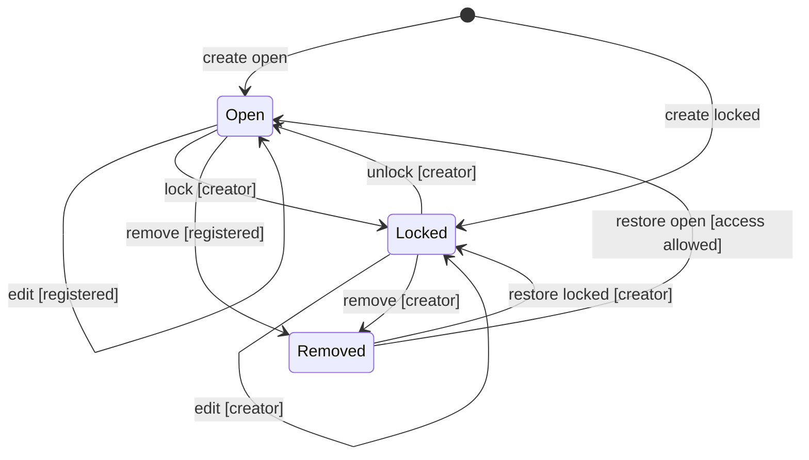

A new person node records its creator and starts unlocked. A creator can lock it at creation or in a later edit. The server decides access from the stored creator ID and lock state. It does not trust creator IDs from an edit request.

## Open

Any registered user can edit the node. Only its creator can change the lock. Creator identity does not change when someone else edits it.

## Locked

Only the creator can edit or remove the node. Changes to relationships check both their previous and proposed endpoints. A change cannot remove or move a relationship away from a locked person without access to that person. If both endpoints are locked, the user must have access to both. Lock refusal returns HTTP 403. The same rules apply to undo and restore.

## Removed

Removal saves a deleted revision. It also removes linked relationships, so locks on other endpoints can refuse the operation. The stored creator and lock remain. A restore must pass the same access checks. The node can be restored unlocked by another registered user only if it was already unlocked when removed.

## Refused requests

Guests cannot write. Other users cannot change a lock. A stale node revision returns HTTP 409. A stale database sequence causes a retry against new data. After five failed attempts, the server returns HTTP 503. No failed batch changes the graph.

## Gaps

There is no creator-recovery or moderation process. A creator cannot change a relationship to another creator's locked node. There is no automatic duplicate-person merge. These behaviors have no additional user controls in this version.
